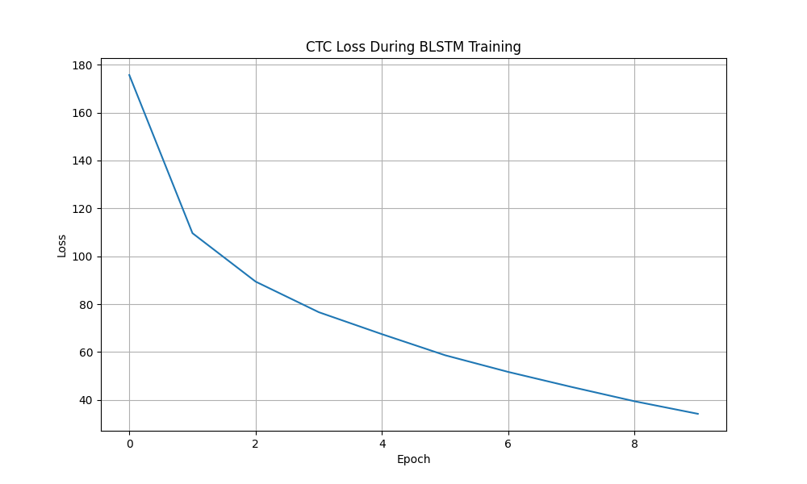

# BLSTM-CTC Speech Recognition from Scratch

A bidirectional LSTM trained with **Connectionist Temporal Classification (CTC)** to recognise
phonemes in raw speech, written from scratch in **pure NumPy**: no PyTorch, no TensorFlow, no
autograd. Every forward pass, every backward pass through time, the CTC forward-backward
algorithm and both decoders are implemented by hand in a single file,
[`blstm_ctc.py`](blstm_ctc.py).

It reproduces the core method of:

> Alex Graves, Santiago Fernández, Faustino Gomez, and Jürgen Schmidhuber. 2006.
> *Connectionist temporal classification: labelling unsegmented sequence data with recurrent
> neural networks.* ICML '06. https://doi.org/10.1145/1143844.1143891

CTC is what lets a network learn from audio paired only with its transcription, with no
frame-by-frame alignment: the loss sums over every possible alignment of the label sequence to
the input frames.

## Results

Trained on a 320-utterance subset of TIMIT (256 train / 64 held-out), for 10 epochs, on a
laptop CPU (Intel i5-1035G1, no GPU, ~1.6 min per epoch).

| Decoder | Phoneme label error rate (64 held-out utterances) |
|---|---|
| Best path (greedy) | **37.0%** |
| Prefix beam search (width 5) | **36.1%** |

For reference, the paper reports about 30–31% LER with the full TIMIT training set (3,696
utterances, more than 14× the data used here) and 61 phonemes.

### Training loss



| Epoch | 1 | 2 | 3 | 4 | 5 | 6 | 7 | 8 | 9 | 10 |
|---|---|---|---|---|---|---|---|---|---|---|
| Avg CTC loss | 175.7 | 109.6 | 89.4 | 76.6 | 67.5 | 58.7 | 51.7 | 45.4 | 39.4 | 34.2 |

### Learning to listen

One held-out utterance decoded after each epoch shows the network going from noise to speech:

```
Target  : h# dh ix m ao nx iy ng dcl d uw q ah n dh uh s pcl p ay dx ih w eh bcl pau g l ih s ih n dcl d ax-h pau q ih n dh ax s ah n h#
          ("The morning dew on the spider web glistened in the sun.")

Epoch 1 : s kcl s h#                                                                        LER 0.93
Epoch 2 : h# ax n iy n ih s ae n ix tcl ix n ih s n h#                                      LER 0.71
Epoch 5 : h# dh ax bcl ao nx d aa n ih s pcl ae dcl w bcl ih s eh n t ix pcl ih n ih s ah n h#   LER 0.47
Epoch 10: h# dh ax m ao nx dcl d l ao n ih s pcl ae dcl d ix ih ax w ae bcl g ih s ah t ix m dh ax s ah n z h#   LER 0.44
```

### Sample outputs on held-out data

```
"Dogs did something to one's ego."
  Target       : h# d ao gcl g z dcl d ih dcl d s ah m th ih ng tcl t ax w ah n z q iy gcl g ow h#
  Best path    : h# d aa gcl kcl s d ix dcl s ah tcl d ih ng n tcl t ax ah n z dcl d iy n y l h#   LER 0.37

"Ralph controlled the stopwatch from the bleachers."
  Target       : h# r ae l f kcl k ix n tcl t r ow l dh ax s tcl t aa pcl w aa tcl ch f r ax m ax bcl b l iy tcl ch axr s h#
  Beam search  : h# r l f k t ix n kcl r l dcl dh ax s tcl t aa pcl b aa tcl f ah m ax bcl b l iy tcl ch axr z h#   LER 0.19

"She had your dark suit in greasy wash water all year."
  Target       : h# sh iy hv ae dcl d y er dcl d aa r kcl k s uw dx ih ng gcl g r iy s iy w aa sh epi w aa dx er q ao l y iy axr h#
  Best path    : h# sh iy hv ae dcl d y axr dcl d aa r kcl k s ux dcl d ix n ix gcl g r iy s w aa sh aa dx ao l ih axr h#   LER 0.25
```

Most errors are between acoustically close phonemes (`er`/`axr`, `uw`/`ux`, `ih`/`ix`, `z`/`s`),
the same confusions TIMIT systems usually make. The full training and evaluation log is in
[`results.txt`](results.txt).

## What's implemented

- **LSTM cell with manual backpropagation through time**: input, forget and output gates,
  cell state, full gradient derivation for every weight, Xavier/Glorot initialisation.
- **Bidirectional LSTM**: a forward and a backward LSTM whose outputs are concatenated and fed
  to a softmax layer over the phonemes plus the CTC blank.
- **CTC loss and gradient**: the forward-backward (α/β) recursion over the blank-augmented label
  sequence, with per-timestep rescaling for numerical stability, exactly as in the paper; the
  gradient is taken with respect to the softmax inputs.
- **Optimisation**: SGD with momentum (0.9) and gradient clipping (±5), one utterance per update.
- **Decoding**:
  - *best path*: the most likely label at each frame, then repeats merged and blanks removed;
  - *prefix beam search*: keeps the most probable label prefixes, tracking blank- and
    non-blank-ending probabilities separately in log space, so it sums over alignments rather
    than following a single path.
- **Features**: 13 MFCCs with deltas and delta-deltas (39 dimensions), 25 ms windows with a 10 ms
  hop, normalised with the training set's mean and variance.
- **Evaluation**: label error rate, i.e. edit distance between decoded and target phoneme
  sequences divided by the target length.

Hyperparameters live in the `Config` dataclass at the top of the script (hidden size 20 per
direction, learning rate 1e-3, momentum 0.9, beam width 5).

## Running it

```bash
python -m venv .venv && source .venv/bin/activate
pip install -r requirements.txt
```

The script expects the TIMIT corpus (LDC93S1) in a `TIMIT/` directory next to it, containing
`TRAIN/` and `TEST/`. TIMIT is distributed by the
[Linguistic Data Consortium](https://catalog.ldc.upenn.edu/LDC93S1); a copy is also on
[figshare](https://figshare.com/articles/dataset/TIMIT_zip/5802597), where the zip extracts into a
nested tree: move the inner `TIMIT` directory (the one holding `TRAIN` and `TEST`) next to the
script.

```bash
python blstm_ctc.py
```

It loads the first 320 utterances, shuffles them with a fixed seed, splits 80/20, trains, decodes
one held-out utterance after every epoch, evaluates on the whole held-out set, and saves the model
weights (`blstm_ctc_final_model.npz`) and the loss plot (`blstm_training_history.png`). Raise
`MAX_SAMPLES_TO_LOAD` in `Config` to train on more data.

## Limitations and next steps

- Everything is plain NumPy loops on the CPU, one utterance at a time, so training is slow;
  the 320-utterance subset is a hardware constraint, not a design choice. More data and epochs
  should close most of the gap to the paper.
- The CTC recursion is written for clarity, not speed; vectorising it over the label axis is the
  obvious first optimisation.
- The held-out utterances come from the same pool as the training set, not TIMIT's speaker-disjoint
  core test set, so the numbers are not directly comparable with published results.

## References

- A. Graves, S. Fernández, F. Gomez, J. Schmidhuber. *Connectionist temporal classification:
  labelling unsegmented sequence data with recurrent neural networks.* ICML 2006.
  [doi:10.1145/1143844.1143891](https://doi.org/10.1145/1143844.1143891)
- J. S. Garofolo et al. *TIMIT Acoustic-Phonetic Continuous Speech Corpus* (LDC93S1). Linguistic
  Data Consortium, 1993.
- Libraries: [NumPy](https://numpy.org/), [librosa](https://librosa.org/) (MFCCs),
  [Levenshtein](https://pypi.org/project/Levenshtein/) (edit distance),
  [tqdm](https://tqdm.github.io/), [matplotlib](https://matplotlib.org/).
